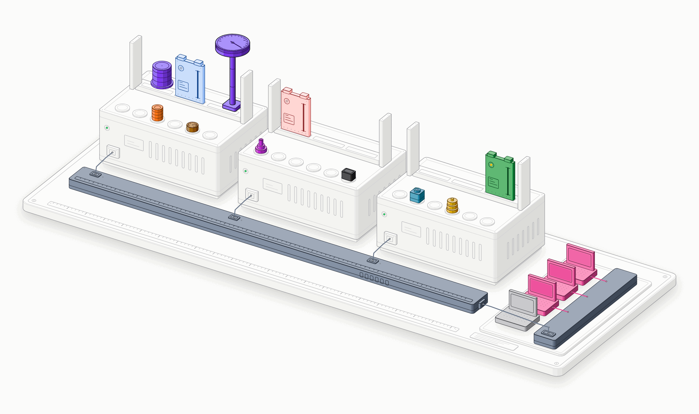
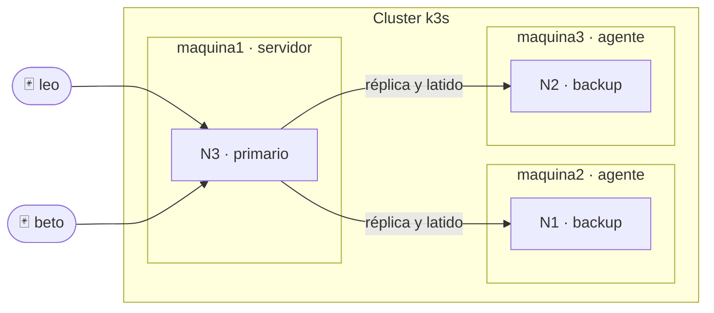
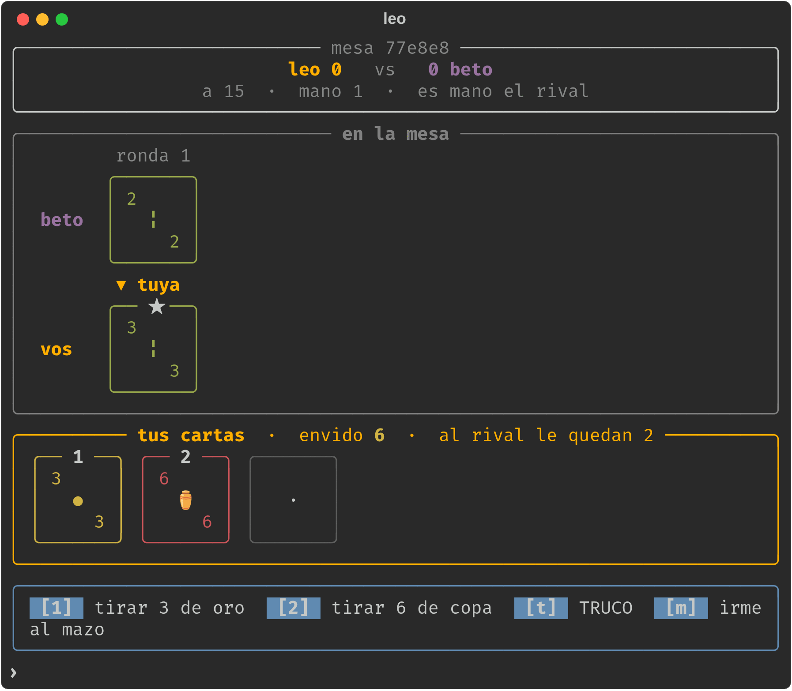
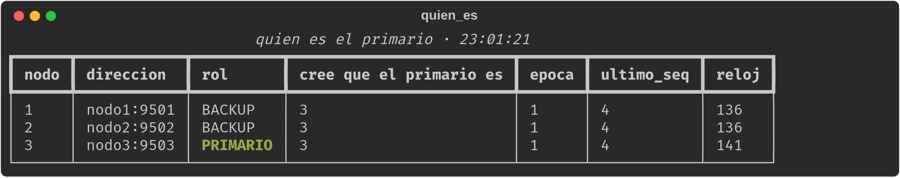
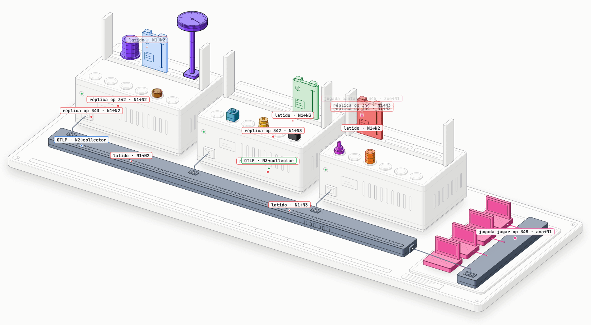
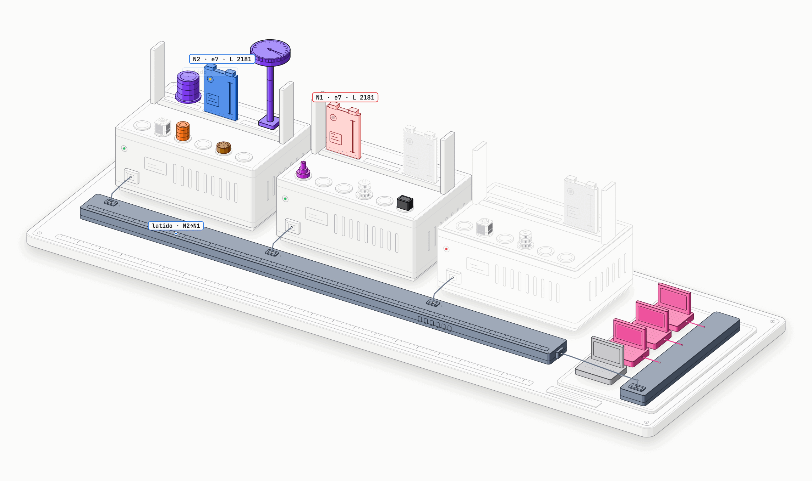
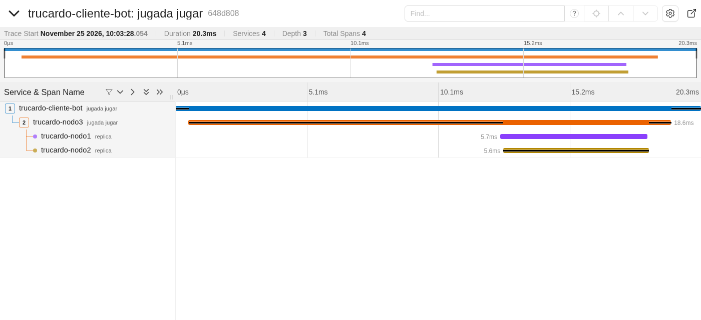
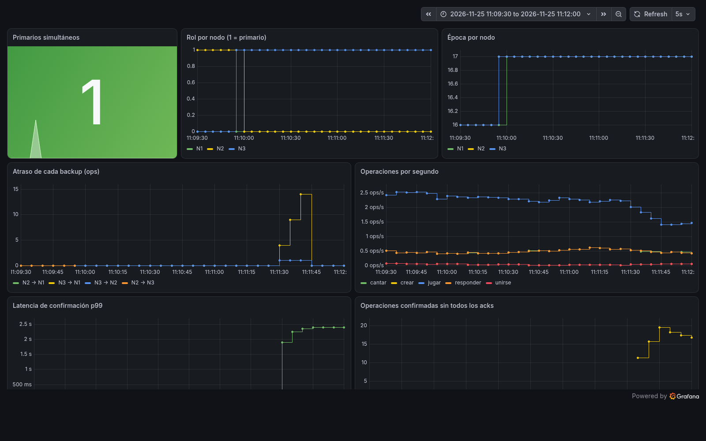

<p align="center">
  
</p>

<h1 align="center">Trucardo en k3s</h1>

<p align="center">
  <b>Truco por turnos para dos jugadores, servido por tres nodos que se replican entre sí,<br>
  sobre un cluster Kubernetes de tres máquinas. Se apaga una máquina y la partida sigue.</b>
</p>

<p align="center">
  
  
  
  
</p>

<p align="center">
  <a href="#probalo-en-un-minuto">Probalo en un minuto</a> ·
  <a href="#en-kubernetes">En Kubernetes</a> ·
  <a href="#provocá-fallas">Provocá fallas</a> ·
  <a href="#en-tres-máquinas-reales">Tres máquinas reales</a>
</p>

---

## Qué es

**Trucardo** es un servicio de truco distribuido. Dos jugadores se sientan a una mesa desde su terminal, y tres nodos guardan la partida: uno es el **primario**, que recibe las jugadas, y los otros dos son **backups**, que reciben cada jugada replicada. Si el primario se cae, los backups lo notan en tres segundos, eligen otro y los clientes siguen jugando contra el nuevo.

Este proyecto lo lleva a **k3s**, un Kubernetes liviano, repartido en tres máquinas:



Cada capa hace lo suyo:

| | Se ocupa de | Cuándo actúa |
| --- | --- | --- |
| **Trucardo** | quién es el primario y qué pasó en cada mesa | a los **3 s** de que el primario deje de latir |
| **Kubernetes** | que cada nodo exista: lo reinicia, lo muda de máquina, lo actualiza | en **≈1 min**, cuando una máquina no responde |

Cada nodo guarda su log en disco, así que un apagón de las tres máquinas no pierde las partidas. Y, si se quiere mirar por dentro, se suman **trazas, métricas y logs** con OpenTelemetry y un **visor en vivo** que dibuja el cluster con cada mensaje que viaja.

## Cómo se ve

<table>
  <tr>
    <td width="50%"></td>
    <td width="50%">
      <b>El juego, en la terminal.</b><br>
      Cada jugador ve el marcador, las cartas de la mesa, las suyas y lo que puede hacer: tirar una carta, cantar envido o truco, o irse al mazo. Elige con una tecla.
      <br><br>
      
      <br>
      <code>quien_es</code> muestra qué cree cada nodo: quién es el primario, en qué época está y hasta qué operación tiene.
    </td>
  </tr>
</table>

**El visor en vivo** muestra el cluster como una maqueta: cada máquina, el nodo que corre en ella, la red y los jugadores. Cada componente tiene su color, y cada mensaje viaja como un punto con un cartel que dice qué lleva y de quién a quién.

<p align="center">
  
</p>

Cuando se apaga una máquina, el visor la muestra gris, con su luz en rojo, y los nodos que quedan eligen un primario nuevo:

<p align="center">
  
</p>

**Con telemetría**, cada jugada queda como una traza en Jaeger, y Grafana tiene un tablero con el rol, la época y el atraso de cada nodo:

<table>
  <tr>
    <td width="50%"></td>
    <td width="50%"></td>
  </tr>
  <tr>
    <td align="center"><sub>Una jugada: del cliente al primario, y del primario a los dos backups</sub></td>
    <td align="center"><sub>El tablero mientras cae un primario y otro toma su lugar</sub></td>
  </tr>
</table>

## Probalo en un minuto

Sólo hace falta Docker con el plugin `compose`. Todos los comandos se corren desde la raíz del repo.

Levantá los tres nodos:

```bash
docker compose up --build
```

En otras dos terminales, un jugador en cada una:

```bash
docker compose run --rm cliente leo
```

```bash
docker compose run --rm cliente beto
```

En una cuarta, mirá quién es el primario, actualizado cada segundo:

```bash
docker compose run --rm quien_es --seguir
```

Ahora apagá al primario (al arrancar suele ser el nodo 3) y seguí jugando: en unos segundos otro nodo toma su lugar.

```bash
docker compose stop nodo3
```

Cuando vuelve, se pone al día solo:

```bash
docker compose start nodo3
```

Para ver la historia de una mesa, operación por operación:

```bash
docker compose run --rm historial
```

Cada nodo guarda su log en un volumen, así que las partidas sobreviven a `docker compose down`. Para empezar de cero:

```bash
docker compose down -v
```

> [!TIP]
> **El visor, sin levantar nada.** `python3 -m http.server -d visor/pagina 8000` y abrí <http://localhost:8000/?demo>: simula un cluster en el navegador, con una máquina que se cae una vez por minuto.

## En Kubernetes

El cluster local simula tres máquinas con k3s dentro de contenedores: `maquina1` es el servidor y `maquina2` y `maquina3` son agentes, con IPs `172.30.0.11` a `172.30.0.13`.

**1. Construí la imagen y levantá el cluster.**

```bash
docker compose build nodo1
```

```bash
docker compose -f despliegue/cluster-local/compose.yaml up -d
```

Esperá a que las tres máquinas estén `Ready`:

```bash
docker compose -f despliegue/cluster-local/compose.yaml exec maquina1 kubectl get nodes
```

**2. Cargá la imagen en las tres máquinas.**

```bash
sh despliegue/cluster-local/cargar-imagen.sh
```

**3. Generá los manifiestos y aplicalos.** El generador arma un nodo por máquina a partir de la lista de nodos:

```bash
TRUCARDO_NODOS="1@nodo1:9501:9601,2@nodo2:9502:9602,3@nodo3:9503:9603" python3 -m despliegue.manifiestos --imagen trucardo:local > trucardo.json
```

```bash
docker compose -f despliegue/cluster-local/compose.yaml exec -T maquina1 kubectl apply -f - < trucardo.json
```

Vas a ver un Pod por máquina:

```bash
docker compose -f despliegue/cluster-local/compose.yaml exec maquina1 kubectl get pods -o wide
```

**4. Jugá.** Los clientes corren fuera del cluster y entran por la IP de una máquina, en el puerto del nodo + 21000:

```bash
docker run --rm -it --network trucardo-k3s_maquinas -e TRUCARDO_NODOS="1@172.30.0.11:30501:30601,2@172.30.0.11:30502:30602,3@172.30.0.11:30503:30603" trucardo:local python -m cliente.cliente leo
```

Para otro jugador o para `quien_es`, el mismo comando cambiando el final: `python -m cliente.cliente beto` o `python -m cliente.quien_es --seguir`. Si cambiás la lista de nodos, el valor para los clientes sale de `python3 -m despliegue.manifiestos --clientes 172.30.0.11`.

**5. Apagalo** (los logs de los nodos se conservan; para borrarlos, sumá `-v`):

```bash
docker compose -f despliegue/cluster-local/compose.yaml down
```

### Telemetría y visor

El generador suma dos extras con sus opciones:

| Opción | Qué agrega | Dónde se ve |
| --- | --- | --- |
| `--telemetria` | Collector de OpenTelemetry, Jaeger, Prometheus, Loki y Grafana con el tablero «Trucardo» | Grafana <http://172.30.0.11:30300> · Jaeger <http://172.30.0.11:30686> · Prometheus <http://172.30.0.11:30090> |
| `--visor` | El visor en vivo, con barra «Mostrar» para elegir qué mensajes ver | <http://172.30.0.11:30808> |

Primero cargá las imágenes de la telemetría en las máquinas:

```bash
for i in jaegertracing/jaeger:2.23.0 otel/opentelemetry-collector:0.165.0 prom/prometheus:v3.16.0 grafana/loki:3.6.22 grafana/grafana:13.3.2; do sh despliegue/cluster-local/cargar-imagen.sh $i; done
```

Después generá los manifiestos con las dos opciones y aplicalos como en el paso 3:

```bash
TRUCARDO_NODOS="1@nodo1:9501:9601,2@nodo2:9502:9602,3@nodo3:9503:9603" python3 -m despliegue.manifiestos --imagen trucardo:local --telemetria --visor > trucardo.json
```

Para que los jugadores también aparezcan en las trazas, sumá `-e OTEL_EXPORTER_OTLP_ENDPOINT=http://172.30.0.11:30318` al `docker run` del cliente.

Sin Kubernetes, la misma telemetría se levanta con `OTEL_EXPORTER_OTLP_ENDPOINT=http://collector:4318 docker compose --profile telemetria up --build`, con Grafana en <http://localhost:3000>.

> [!TIP]
> En el visor, un clic en cada pieza explica qué es y muestra sus datos del momento. Para presentar, conviene dejar prendidos sólo los mensajes que se están explicando (por ejemplo, jugadas y réplicas) y activar la cámara lenta.

## Provocá fallas

Con el cluster local andando y el visor abierto, definí un atajo:

```bash
C="docker compose -f despliegue/cluster-local/compose.yaml"
```

| Qué probar | Comando | Qué se ve |
| --- | --- | --- |
| Matar el Pod del primario | `$C exec maquina1 kubectl delete pod -l app=trucardo,nodo=3` | Los backups eligen otro primario en segundos; Kubernetes crea un Pod nuevo, que vuelve como backup y se pone al día |
| Apagar una máquina | `$C stop maquina3` | Si tenía al primario, otro toma su lugar; al minuto, su nodo renace en otra máquina |
| Volver a prenderla | `$C start maquina3` | La máquina vuelve a `Ready` y acepta Pods de nuevo |
| Apagar el servidor k3s | `$C stop maquina1` | El juego sigue: lo que ya corre no depende del plano de control |

[experimentos/README.md](experimentos/README.md) tiene 19 casos con su guion, lo que se espera y la evidencia de una corrida real: fallas de proceso y de máquina, una partición de red, un apagón total, y cómo se ve cada uno en Jaeger y en Grafana.

## En tres máquinas reales

<details>
<summary><b>Guía paso a paso</b>: tres computadoras Linux con <code>systemd</code> en la misma red</summary>

<br>

Hacen falta tres computadoras Linux con `systemd` en la misma red, cada una con IP fija o reservada, un nombre de host distinto (`hostname`), `sudo` y `curl`. Además, una «compu de armado» con Docker, `python3` y este repo (puede ser una de las tres).

En los ejemplos: `maquina1` con `192.168.0.11` (servidor k3s), `maquina2` con `192.168.0.12` y `maquina3` con `192.168.0.13` (agentes). Reemplazá las IPs por las de ustedes.

### 1. En la compu de armado

Construí la imagen y guardala en un archivo `.tar` para cargarla sin registro de imágenes:

```bash
docker compose build nodo1
```

```bash
docker save trucardo:local -o trucardo.tar
```

Generá los manifiestos:

```bash
TRUCARDO_NODOS="1@nodo1:9501:9601,2@nodo2:9502:9602,3@nodo3:9503:9603" python3 -m despliegue.manifiestos --imagen trucardo:local > trucardo.json
```

Cada nodo tiene una IP de Service fija (`10.43.0.101` para el nodo 1, y así), dentro del rango que k3s usa por defecto, `10.43.0.0/16`. Si instalás k3s con otro `--service-cidr`, cambialas en `despliegue/manifiestos.py`.

Anotá la versión de k3s (va donde dice `<version>` más abajo):

```bash
sed -n 's|.*rancher/k3s:\(v.*\)-\(k3s.*\)|\1+\2|p' despliegue/cluster-local/compose.yaml
```

Copiá `trucardo.tar` a las tres máquinas y `trucardo.json` a `maquina1`:

```bash
scp trucardo.tar trucardo.json usuario@192.168.0.11:
```

```bash
scp trucardo.tar usuario@192.168.0.12:
```

```bash
scp trucardo.tar usuario@192.168.0.13:
```

### 2. En las tres máquinas: firewall

Si `sudo ufw status` dice `inactive`, salteá este paso. Si está activo:

```bash
sudo ufw allow 6443/tcp            # API de Kubernetes (los agentes se unen al servidor)
sudo ufw allow 8472/udp            # red entre Pods (VXLAN de Flannel)
sudo ufw allow 10250/tcp           # kubelet (logs y exec de los Pods)
sudo ufw allow 30000:32767/tcp     # NodePort: los clientes entran por acá
sudo ufw allow from 10.42.0.0/16   # Pods
sudo ufw allow from 10.43.0.0/16   # Services
```

### 3. En maquina1: servidor

```bash
curl -sfL https://get.k3s.io | INSTALL_K3S_VERSION=<version> sh -s - server --disable traefik --disable metrics-server
```

Copiá el token del servidor:

```bash
sudo cat /var/lib/rancher/k3s/server/node-token
```

### 4. En maquina2 y maquina3: agentes

```bash
curl -sfL https://get.k3s.io | INSTALL_K3S_VERSION=<version> K3S_URL=https://192.168.0.11:6443 K3S_TOKEN=<token> sh -s - agent
```

### 5. En maquina1: verificar

```bash
sudo k3s kubectl get nodes -o wide
```

### 6. En las tres: cargar la imagen

```bash
sudo k3s ctr images import trucardo.tar
```

### 7. En maquina1: aplicar

```bash
sudo k3s kubectl apply -f trucardo.json
```

```bash
sudo k3s kubectl get pods -o wide
```

### 8. Jugar

Desde cualquier compu de la red con Docker y la imagen `trucardo:local`:

```bash
docker run --rm -it --network host -e TRUCARDO_NODOS="1@192.168.0.11:30501:30601,2@192.168.0.11:30502:30602,3@192.168.0.11:30503:30603" trucardo:local python -m cliente.cliente leo
```

### 9. Desinstalar

En `maquina1`:

```bash
sudo /usr/local/bin/k3s-uninstall.sh
```

En `maquina2` y `maquina3`:

```bash
sudo /usr/local/bin/k3s-agent-uninstall.sh
```

Los logs de los nodos quedan en `/var/lib/trucardo` de cada máquina. Para borrarlos:

```bash
sudo rm -rf /var/lib/trucardo
```

### Si algo falla

- **Logs:** `sudo journalctl -u k3s` (servidor) y `sudo journalctl -u k3s-agent` (agentes).
- **Un agente no aparece en `get nodes`:** desde ese agente, `curl -k https://192.168.0.11:6443` tiene que contestar (un `401` en JSON está bien); si no, revisá el firewall y la IP.
- **Máquinas clonadas con el mismo `hostname`:** cambiá el `hostname` o sumá `--node-name <nombre>` al comando de instalación.
- **Máquinas con varias interfaces de red:** sumá `--node-ip <ip de esa máquina>` al comando de instalación.
- **Pods en `ErrImagePull` o `ImagePullBackOff`:** falta el paso 6 en esa máquina.

</details>

<details>
<summary><b>Opcional: disco replicado con Longhorn</b> (sin probar en máquinas reales)</summary>

<br>

Con Longhorn, cada nodo guarda su log en un volumen replicado en las tres máquinas, que viaja con el Pod si se muda. Necesita `open-iscsi` en cada máquina. En Debian o Ubuntu, en las tres:

```bash
sudo apt install -y open-iscsi && sudo systemctl enable --now iscsid && sudo modprobe iscsi_tcp
```

En `maquina1`, instalá Longhorn y esperá a que sus Pods estén `Running`:

```bash
sudo k3s kubectl apply -f https://raw.githubusercontent.com/longhorn/longhorn/v1.13.0/deploy/longhorn.yaml
```

```bash
sudo k3s kubectl -n longhorn-system get pods
```

Hacé que, si se apaga una máquina, Longhorn libere el volumen del Pod para que pueda montarse en otra:

```bash
sudo k3s kubectl -n longhorn-system patch settings.longhorn.io node-down-pod-deletion-policy --type merge -p '{"value":"delete-both-statefulset-and-deployment-pod"}'
```

Generá los manifiestos con `--almacenamiento longhorn` y aplicalos como en el paso 7:

```bash
TRUCARDO_NODOS="1@nodo1:9501:9601,2@nodo2:9502:9602,3@nodo3:9503:9603" python3 -m despliegue.manifiestos --imagen trucardo:local --almacenamiento longhorn > trucardo.json
```

Longhorn no corre en el cluster local: expone cada volumen por iSCSI, y eso no funciona dentro de un contenedor.

</details>

## Tests

```bash
docker compose run --build --rm tests
```

## Lo que no cubre

- **Una partición de red deja dos primarios** hasta que se cura. Las épocas ordenan todo al reunirse, pero lo que confirmó el primario aislado se pierde.
- **Después de un apagón total, el primero en volver se corona.** Si es un backup atrasado, lo que él no tenía se pierde.
- **Los clientes entran por la IP de una máquina.** Si esa máquina se apaga, hay que apuntarlos a otra.
- **La telemetría guarda su historia en el Pod.** Si Jaeger, Prometheus o Loki se mudan de máquina, empiezan de cero.

## Créditos

Hecho por **Nehuén García** y **Alan Viera** para la promoción de Sistemas Distribuidos 2026 (UNPSJB).

Se basa en **Trucardo**, el Proyecto 1 de la materia: el juego, el protocolo primario-backup, la elección Bully con épocas, el log replicado, los relojes de Lamport y los clientes. Su versión original está en el tag [`proyecto1-base`](https://github.com/cosmosnehu77/trucardo-k3s/tree/proyecto1-base), con su propia guía para jugar en varias computadoras sin Kubernetes.

El visor usa el kit isométrico de [anatomy](https://github.com/wheresryan22/anatomy), con licencia MIT (`visor/figura/kit/LICENSE`).
