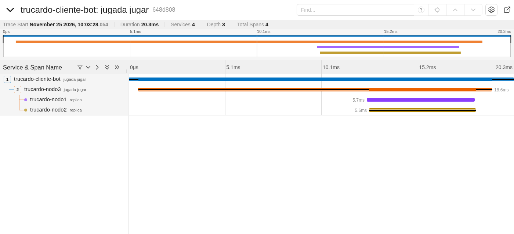
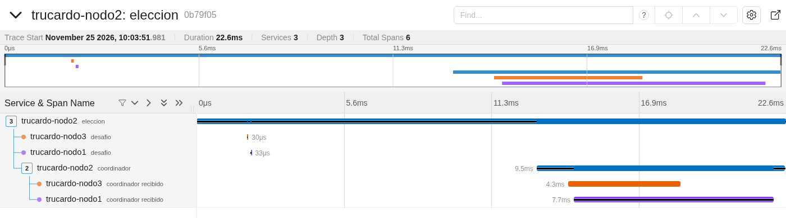
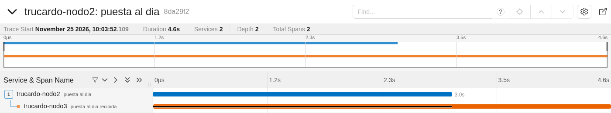
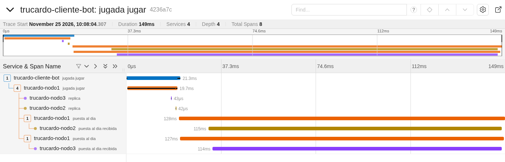
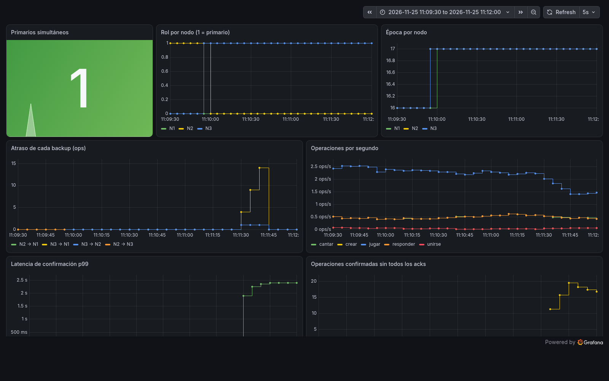
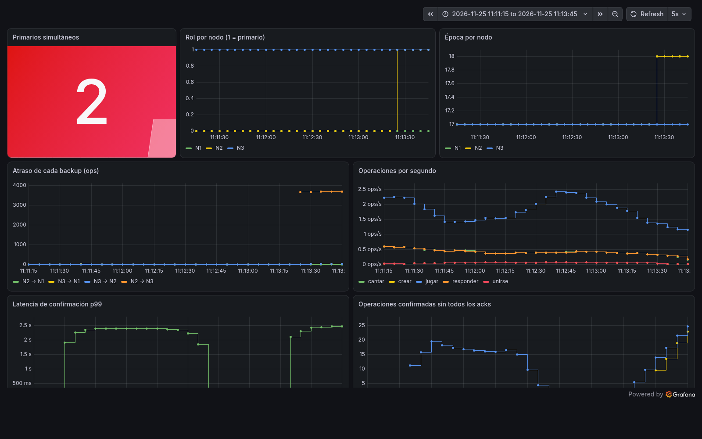
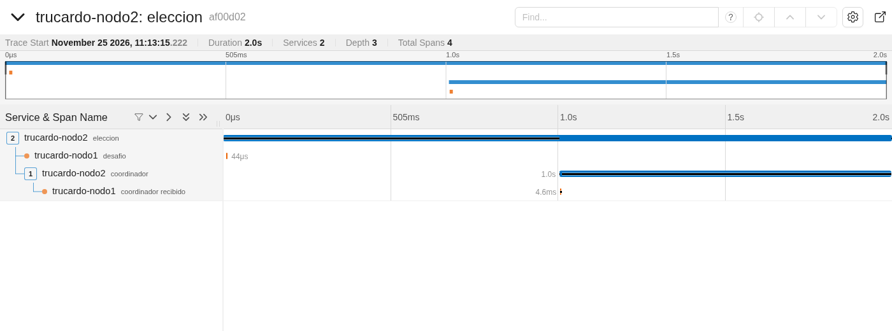

# Experimentos

Qué pasa cuando algo falla con Trucardo en k3s, caso por caso. Cada caso tiene el guion para repetirlo, lo que se espera ver, la evidencia de una corrida real y **por qué** pasa lo que pasa.

Hay dos capas que reaccionan a una falla, y los experimentos muestran cómo se reparten el trabajo:

- **Trucardo** detecta en segundos que el primario no late (`TIMEOUT_CAIDO` = 3 s), elige otro y la partida sigue;
- **Kubernetes** repara después: vuelve a crear el Pod que falta, en la misma máquina o en otra. Tarda más, porque detectar una máquina caída le lleva unos 40 s, a los que suma 10 s de tolerancia (D8).

## Preparación

Todo corre en el cluster local de la #8. Levantalo, cargá la imagen y aplicá los manifiestos con los pasos del [README](../README.md#cluster-local-de-desarrollo-k3s-en-contenedores).

Para acortar los comandos, en cada terminal definí:

```bash
C="docker compose -f despliegue/cluster-local/compose.yaml"
k() { $C exec -T maquina1 kubectl "$@"; }
VALOR="1@172.30.0.11:30501:30601,2@172.30.0.11:30502:30602,3@172.30.0.11:30503:30603"
quien_es() { docker run --rm -it --network trucardo-k3s_maquinas -e TRUCARDO_NODOS="$VALOR" trucardo:local python -m cliente.quien_es "$@"; }
```

`VALOR` es la salida de `--clientes 172.30.0.11` (ver el README): los clientes entran por la IP de `maquina1`.

Durante cada caso conviene tener abiertas:

- dos terminales con `leo` y `beto` jugando una partida (comandos en el README);
- una con `quien_es --seguir`, que actualiza la tabla cada segundo;
- una con el log del nodo que interese: `k logs -f deploy/trucardo-nodo<id>`.

Para colgar o matar el proceso de un nodo hace falta su PID **dentro de la máquina** donde corre su Pod (columna `NODE` de `k get pods -o wide`):

```bash
$C exec -T maquina3 ps -eo pid,args | grep "nodo.servidor 2"
```

### Cómo leer la evidencia

- Las salidas son de una corrida del 25/11/2026, en orden y con la hora de cada línea. Se recortaron líneas repetidas.
- Las tablas de `quien_es` se abrevian a sus columnas: nodo, rol, primario que cree, época y `ultimo_seq`.
- En la evidencia, `leo` y `beto` juegan solos, con jugadas al azar, mediante un script de prueba que usa la misma conexión que el cliente. Cada jugada se anota así:

  ```
  07:41:19 beto: tira 12 de oro (primario N2, 4.2 s)
  ```

  El número final es lo que tardó la jugada, contando los reintentos del cliente. Jugando a mano se ve lo mismo, pero más lento.
- Desde la #24 cada nodo guarda su log en el disco de su máquina, en `/var/lib/trucardo/nodo<id>`. Los casos 1 a 7 no dependen de eso. Los casos 8 a 11, de [persistencia](#persistencia), lo usan a propósito.

---

## 1. Borrar el Pod del primario

**Guion.** Con la partida en curso, borrá el Pod del primario (N3 en la corrida):

```bash
k delete pod -l nodo=3 --wait=false
```

**Qué se espera.** Los backups dejan de recibir latidos y eligen otro primario en unos 5 s. Mientras tanto, Kubernetes ya creó el Pod nuevo, que entra como backup y se pone al día.

**Evidencia.**

```
07:41:13 kubectl delete pod -l nodo=3
07:41:13 beto: tira 1 de oro (primario N3, 0.0 s)
07:41:15 [N3│BACKUP│e=0] escuchando en PYRO:truco@…:9503          ← el Pod nuevo, en maquina3
07:41:16 [N1│BACKUP│e=1] 3.1 s sin latido de N3: lo doy por caido
07:41:17 [N3│BACKUP│e=0] arranco una eleccion (epoca_ultima 0, ultimo_seq 0)
07:41:17 [N3│BACKUP│e=0] me gana otro candidato: espero su COORDINADOR
07:41:18 [N2│BACKUP│e=1] arranco una eleccion (epoca_ultima 1, ultimo_seq 24)
07:41:18 [N2│BACKUP│e=1] nadie me gana (contestaron 2 de 2): me corono
07:41:18 [N2│PRIMARIO│e=2] gano la eleccion: soy el primario de la epoca 2
07:41:19 beto: tira 12 de oro (primario N2, 4.2 s)
07:41:19 [N2│PRIMARIO│e=2] N3 esta en la op 0 y yo en la 24: le mando las 24 que le faltan
07:41:19 [N2│PRIMARIO│e=2] N3 quedo al dia en la op 24
```

**Por qué.**

- **Kubernetes no espera a Trucardo.** Al borrar el Pod, el ReplicaSet crea otro enseguida, 2 s antes de que los backups noten la falta del primario. Como la anti-afinidad es preferida (D9) y `maquina1` todavía tenía el Pod viejo terminando, el nuevo fue a `maquina3`.
- **El Pod nuevo no se queda con el puesto.** N3 tiene el id mayor, pero arranca con el log vacío. Las credenciales de la elección comparan primero la frescura del log (época de la última op, `ultimo_seq`) y recién después el id (#23), así que N3 pierde contra N1 y N2.
- **La jugada no se pierde.** El cliente reintenta durante 25 s (`REINTENTO_TOTAL`) y su jugada entra con el primario nuevo, 4,2 s después.
- **Por qué arrancó vacío.** Se mudó a `maquina3`, que no tenía su log, y se puso al día por la red. Si hubiera vuelto a `maquina1`, habría arrancado con su disco.

## 2. Colgar un nodo (`kill -STOP`)

**Guion.** Colgá el proceso del primario (N2, en `maquina3`), esperá unos 25 s y reanudalo:

```bash
$C exec -T maquina3 kill -STOP <pid>
```

```bash
$C exec -T maquina3 kill -CONT <pid>
```

**Qué se espera.** Para Trucardo, un nodo colgado es igual a uno caído: los backups eligen otro primario. Kubernetes, en cambio, **no se entera**. Al reanudarlo, el primario viejo descubre que hay una época mayor y se degrada a backup.

**Evidencia.**

```
07:42:59 beto: canta truco (primario N2, 0.0 s)
07:43:00 kill -STOP (N2, primario de la época 2)
07:43:03 [N3│BACKUP│e=2] 3.1 s sin latido de N2: lo doy por caido
07:43:05 [N3│BACKUP│e=2] arranco una eleccion (epoca_ultima 2, ultimo_seq 103)
07:43:06 [N3│PRIMARIO│e=3] gano la eleccion: soy el primario de la epoca 3
07:43:07 leo: responde no quiero (primario N3, 6.5 s)

07:43:13 quien_es
1 BACKUP     3  e=3  108
2 no responde
3 PRIMARIO   3  e=3  109
k get pods → los tres Running, RESTARTS 0

07:43:26 kill -CONT
07:43:26 [N2│PRIMARIO│e=2] N1 me rechaza el latido: hay epoca 3 y yo estoy en la 2
07:43:26 [N2│BACKUP│e=3] N3 es el primario de la epoca 3
07:43:26 [N2│BACKUP│e=3] op 104 · responder · leo …              ← se pone al día: 104 a 116
```

**Por qué.**

- **Kubernetes no ve el cuelgue.** La *liveness probe* abre una conexión TCP al puerto del cluster (D7). Con el proceso detenido, el kernel igual acepta la conexión, porque la cola de conexiones del socket la atiende el sistema operativo, no el proceso. Para Kubernetes, el Pod sigue sano.
- **Trucardo sí lo ve**, porque un nodo colgado no late. Al no contestar, a los 3 s los backups lo dan por caído.
- **Las épocas resuelven la vuelta.** Al reanudarse, N2 sigue creyéndose primario de la época 2. Su primer latido le llega a N1, que ya está en la época 3 y lo rechaza. N2 adopta la época 3, pasa a backup y recibe lo que se jugó mientras estaba colgado.

## 3. Apagar una máquina con un backup

**Guion.** Apagá la máquina donde sólo corre un backup (`maquina2`, con N1) y, al rato, volvé a encenderla:

```bash
$C stop -t 0 maquina2
```

```bash
$C start maquina2
```

**Qué se espera.** La partida sigue sin elección, con el otro backup, aunque cada jugada tarda un poco más. Kubernetes marca la máquina `NotReady` y, a los 10 s, recrea el Pod en otra máquina, donde arranca y se pone al día.

**Evidencia.**

```
07:43:56 docker compose stop maquina2
07:43:58 beto: tira 4 de espada (primario N3, 1.0 s)
07:43:59 [N3│PRIMARIO│e=3] N1 fuera de la vista: no contesta el latido
07:44:00 beto: tira 3 de espada (primario N3, 1.0 s)
07:44:01 leo: tira 10 de basto (primario N3, 2.0 s)
          en los 100 s siguientes, ninguna jugada tardó más de 2 s

07:44:40 maquina2=Ready      nodo1:Running@maquina2
07:44:45 maquina2=NotReady   nodo1:Running@maquina2
07:44:53 [N1│BACKUP│e=0] escuchando en PYRO:truco@…:9501     ← en maquina1
07:44:54 [N1│BACKUP│e=0] N3 es el primario de la epoca 3
07:44:54 [N3│PRIMARIO│e=3] N1 entra a la vista (ultimo_seq 0)
07:44:56 maquina2=NotReady   nodo1:Running@maquina1  nodo1:Terminating@maquina2
```

**Por qué.**

- **Para Trucardo, perder un backup cuesta poco.** El primario saca a N1 de la vista en el primer latido sin respuesta. Pero la vista no decide a quién replicar: cada jugada se manda a todos los nodos del cluster, y el primario espera hasta `TIMEOUT_ACK` (1 s) la respuesta de N1. Por eso las jugadas pasan a tardar 1 s, o 2 s si dos se encolan, hasta que el Pod nuevo de N1 contesta.
- **Kubernetes tarda casi un minuto.** El servidor declara `NotReady` a la máquina recién a los ~45 s sin noticias del kubelet. Después aplica los 10 s de tolerancia (D8) y desaloja el Pod.
- **El Pod viejo queda `Terminating`** hasta que vuelva `maquina2`: nadie puede confirmar que el proceso murió, porque el kubelet que lo haría está en la máquina apagada. Al encenderla, el kubelet lo borra.
- **El Pod nuevo arranca vacío**, porque `maquina1` no tenía el log de N1, y se pone al día por la red.

## 4. Apagar la máquina del primario

**Guion.** Apagá la máquina donde corre **sólo** el primario (`maquina3`, con N3) y después volvé a encenderla. Si el primario comparte máquina con un backup, primero borrá el Pod del backup para que se mude.

```bash
$C stop -t 0 maquina3
```

**Qué se espera.** Es el caso 3 más una elección: los backups eligen otro primario en unos 5 s, y Kubernetes recrea el Pod perdido casi un minuto después.

**Evidencia.**

```
07:46:36 leo: responde quiero (primario N3, 0.0 s)
07:46:38 docker compose stop maquina3 (N3, primario)
07:46:41 [N2│BACKUP│e=3] 3.3 s sin latido de N3: lo doy por caido
07:46:42 [N2│BACKUP│e=3] arranco una eleccion (epoca_ultima 3, ultimo_seq 319)
07:46:44 [N2│PRIMARIO│e=4] gano la eleccion: soy el primario de la epoca 4
07:46:45 beto: tira 1 de basto (primario N2, 7.1 s)
07:46:46 leo: canta retruco (primario N2, 8.0 s)

07:47:27 maquina3=NotReady
07:47:38 nodo3:Running@maquina2  nodo3:Terminating@maquina3
07:47:38 [N3│BACKUP│e=0] N2 es el primario de la epoca 4
07:47:38 [N2│PRIMARIO│e=4] N3 esta en la op 0 y yo en la 357: le mando las 357 que le faltan
07:47:39 [N2│PRIMARIO│e=4] N3 quedo al dia en la op 357
```

**Por qué.**

- **La partida se corta unos 8 s**, la suma de la detección (3 s), la espera al azar antes de postularse (`JITTER`), la elección y el reintento del cliente.
- **Kubernetes no participa de la recuperación del servicio:** cuando recrea el Pod, la partida ya lleva casi un minuto jugándose con N2. Sólo devuelve el cluster a tres nodos.
- **La elección no necesitó a Kubernetes**, sólo a los dos backups. Es el reparto de RNF-08: Trucardo decide primero y Kubernetes repara después.

## 5. Actualizar la versión con una partida en curso

**Guion.** Cargá la imagen nueva en las tres máquinas y actualizá los Deployments **de a uno**: primero los backups y al final el primario. En la corrida, la «versión nueva» es la misma imagen con otra etiqueta:

```bash
docker tag trucardo:local trucardo:v2
```

```bash
sh despliegue/cluster-local/cargar-imagen.sh trucardo:v2
```

Por cada nodo, en ese orden:

```bash
k set image deploy/trucardo-nodo1 nodo=trucardo:v2
```

```bash
k rollout status deploy/trucardo-nodo1
```

Antes de pasar al siguiente, confirmá con `quien_es` que el nodo actualizado volvió y tiene el mismo `ultimo_seq` que el resto.

**Qué se espera.** Cada backup se reinicia y se pone al día sin que la partida lo note. Actualizar el primario cuesta una elección, como en el caso 1.

**Evidencia.**

```
07:49:02 set image nodo1 → nodo1 en maquina3: arranca vacío, puesta al dia de la op 0 a la 465
07:49:12 quien_es → 1 BACKUP e=4 474 | 2 PRIMARIO e=4 474 | 3 BACKUP e=4 474
07:49:13 set image nodo3 → nodo3 en maquina1, con el log que dejó ahí en la época 1:
07:49:14 [N3│BACKUP│e=1] escuchando en PYRO:truco@…:9503
07:49:15 [N3│BACKUP│e=4] puesta al dia: de la op 24 a la 476
07:49:21 quien_es → 1 BACKUP e=4 486 | 2 PRIMARIO e=4 486 | 3 BACKUP e=4 486
07:49:22 set image nodo2 (el primario)
07:49:24 [N2│BACKUP│e=4] escuchando en PYRO:truco@…:9502     ← vuelve en maquina2, con su disco
07:49:25 [N2│BACKUP│e=4] arranco una eleccion (epoca_ultima 4, ultimo_seq 486)
07:49:27 [N3│PRIMARIO│e=5] gano la eleccion: soy el primario de la epoca 5
07:49:28 leo: canta envido (primario N3, 4.1 s)
07:49:31 quien_es → 1 BACKUP e=5 492 | 2 BACKUP e=5 492 | 3 PRIMARIO e=5 492

trucardo-nodo1   trucardo:v2
trucardo-nodo2   trucardo:v2
trucardo-nodo3   trucardo:v2
```

Mientras se actualizaban los backups, ninguna jugada tardó más de 1 s.

**Por qué.**

- **De a uno y el primario al final.** Mientras dos nodos están al día, actualizar el tercero no pone en riesgo nada. Si se actualizara primero el primario, la elección se haría con un backup que quizás todavía se está poniendo al día.
- **`Recreate` (D3).** Kubernetes mata el Pod viejo antes de crear el nuevo. Así nunca hay dos procesos con el mismo id, aunque haya unos segundos sin ese nodo. Con `RollingUpdate`, el nuevo arrancaría con el viejo todavía vivo.
- **N2 volvió como backup aunque tenía todo.** Arrancó con su disco y las mismas credenciales que N3, (4, 486). En el empate gana el id mayor, N3. No hubo pérdida: el log de los dos era el mismo.
- **N3 arrancó en la época 1 y se puso al día desde la op 24.** En `maquina1` estaba el log de N3 de cuando era primario, al principio. Sus 24 operaciones coinciden con las del primario, así que sólo recibe lo que sigue (la coincidencia de logs de la #23).

## 6. Apagar el servidor k3s

**Guion.** Apagá `maquina1`, que tiene el plano de control. Antes, cambiá los clientes para que entren por otra máquina, porque la IP de `maquina1` desaparece. Por ejemplo, con `--clientes 172.30.0.12`:

```bash
VALOR="1@172.30.0.12:30501:30601,2@172.30.0.12:30502:30602,3@172.30.0.12:30503:30603"
```

```bash
$C stop -t 0 maquina1
```

Al rato, volvé a encenderla con `$C start maquina1`.

**Qué se esperaba.** Sin plano de control, nadie reprograma nada, pero los Pods de las otras máquinas siguen corriendo y la red entre ellos sigue andando. Trucardo debería elegir otro primario si el que se apagó era el primario, y seguir.

**Qué pasó.** Quedaron **dos primarios**. En la corrida, `maquina1` tenía además al primario, N3:

```
07:50:05 docker compose stop maquina1 (servidor k3s y N3, primario)
07:50:07 [N2│BACKUP│e=5] 3.4 s sin latido de N3: lo doy por caido
07:50:09 [N2│BACKUP│e=5] arranco una eleccion (epoca_ultima 5, ultimo_seq 536)
07:50:13 [N2│BACKUP│e=5] nadie me gana (contestaron 0 de 2): me corono
07:50:13 [N2│PRIMARIO│e=6] gano la eleccion: soy el primario de la epoca 6
          …y N1, en maquina3, también se corona en la época 6

07:50:18 [N1│PRIMARIO│e=6] op 537 · responder · beto · … · la tienen 0/0 de los que contestaron
07:50:20 [N2│PRIMARIO│e=6] op 537 · responder · beto · … · la tienen 0/0 de los que contestaron
07:51:03 leo: tira 11 de oro (primario N1, 15.0 s)
07:51:12 leo: canta truco (primario N1, 7.5 s)

consulta de nombres desde el Pod de N2 (07:51):
nodo1 ERROR [Errno -3] Temporary failure in name resolution   (20 s)
nodo2 ERROR [Errno -3] Temporary failure in name resolution   (20 s)
nodo3 ERROR [Errno -3] Temporary failure in name resolution   (20 s)
```

Al volver `maquina1` (07:53:00), los dos primarios se encuentran:

```
07:53:08 [N1│PRIMARIO│e=6] N2 manda en la epoca 6: dejo de ser primario
07:53:08 [N2│PRIMARIO│e=6] N3 esta en la op 536 y yo en la 558: le mando las 22 que le faltan
07:53:47 quien_es → 1 BACKUP e=6 608 | 2 PRIMARIO e=6 608 | 3 BACKUP e=6 608
```

**Por qué.**

- **Los nodos se buscan por nombre** (`nodo1`, `nodo2`, `nodo3`, D5), y los nombres los resuelve CoreDNS. En k3s, CoreDNS es **una sola réplica** y corre en el servidor:

  ```
  $ k get pods -n kube-system -o custom-columns=POD:.metadata.name,NODO:.spec.nodeName
  coredns-577d995dff-4p782   maquina1
  ```

  Al apagar `maquina1`, `kube-proxy` sigue ruteando en las otras máquinas, pero nadie contesta las consultas de DNS. N1 y N2 no se encuentran, y cada uno gana su elección sin rivales («contestaron 0 de 2»).
- **Por eso cada jugada tardaba 7,5 a 15 s.** Cada envío del primario se quedaba 20 s resolviendo un nombre, pero el primario espera como mucho 2 s por nodo: confirmaba la jugada a los 4 s, con «0/0». El cliente espera 2 s (`TIMEOUT_RPC`) y hace una pausa de 0,5 s, así que cortaba antes y probaba el nodo siguiente. Al dar la vuelta a los tres nodos (7,5 s), el primero ya había terminado y contestaba que era un reintento. Si la consulta anterior también daba la vuelta, sumaba 15 s. Así, cada jugada se aplicó **en los dos** primarios. Por casualidad, los dos logs quedaron iguales, y al reencontrarse no hubo nada que recortar. Con dos clientes entrando por lados distintos, divergirían, como en el caso 7.
- **El servidor de k3s era un punto único de falla para Trucardo**, aunque no debería serlo. Se corrigió en la #52 (ver abajo).
- **Los clientes también dependen de una IP.** El valor de `--clientes` apunta todos los nodos a la IP de una sola máquina. Si esa máquina se apaga, el cliente no llega a nadie aunque los nodos sigan vivos. Por eso hubo que cambiar a `172.30.0.12` antes de apagar.

**Después de la #52.** Cada Service tiene una IP fija (`10.43.0.101` a `10.43.0.103`), y cada Pod tiene esos nombres en su `/etc/hosts`:

```
$ k get svc -o custom-columns=NOMBRE:.metadata.name,IP:.spec.clusterIP
nodo1        10.43.0.101
nodo2        10.43.0.102
nodo3        10.43.0.103

$ k exec <pod de N2> -- cat /etc/hosts
# Entries added by HostAliases.
10.43.0.101	nodo1
10.43.0.102	nodo2
10.43.0.103	nodo3
```

Con el mismo guion (N3, el primario, en `maquina1`) queda **un solo** primario:

```
08:40:18 docker compose stop maquina1 (servidor k3s y N3, primario)
08:40:21 [N2│BACKUP│e=11] 3.5 s sin latido de N3: lo doy por caido
08:40:22 [N1│BACKUP│e=11] arranco una eleccion (epoca_ultima 11, ultimo_seq 1186)
08:40:22 [N2│BACKUP│e=11] arranco una eleccion (epoca_ultima 11, ultimo_seq 1186)
08:40:23 [N2│BACKUP│e=11] nadie me gana (contestaron 1 de 2): me corono
08:40:23 [N2│PRIMARIO│e=12] gano la eleccion: soy el primario de la epoca 12
08:40:23 [N1│BACKUP│e=11] N2 es el primario de la epoca 12
08:40:25 beto: tira 1 de oro (primario N2, 6.6 s)
08:40:29 leo: tira 3 de oro (primario N2, 1.0 s)
08:41:24 beto: tira 10 de copa (primario N2, 1.0 s)

08:41:22 quien_es → 1 BACKUP e=12 1230 | 2 PRIMARIO e=12 1230 | 3 no responde
al volver maquina1 → 1 BACKUP e=12 1237 | 2 PRIMARIO e=12 1237 | 3 BACKUP e=12 1237
```

- **N1 y N2 se encuentran** («contestaron 1 de 2»), porque `nodo1` y `nodo2` se resuelven en `/etc/hosts`. Las IPs de los Services las sigue ruteando `kube-proxy` en cada máquina, sin el servidor.
- **Cada jugada tarda 1 s**, la espera del ack de N3, como en los casos 3 y 4. Esta vez dura hasta que vuelve `maquina1`, porque sin plano de control nadie recrea el Pod de N3 en otra máquina.

## 7. Límite: partición de red

**Guion.** Separá la máquina del primario (`maquina2`, con N2) de las otras dos, con dos jugadores de cada lado: unos entran por `172.30.0.12` y otros por `172.30.0.11`.

```bash
$C exec -T maquina2 sh -c 'for ip in 172.30.0.11 172.30.0.13; do iptables -I INPUT -s $ip -j DROP; iptables -I OUTPUT -d $ip -j DROP; done'
```

Al rato, curá la partición con el mismo comando, cambiando `-I` por `-D`.

**Qué se espera.** Es el límite que el plan acepta (D4): Trucardo no tiene quórum, así que cada lado tiene su primario y confirma jugadas que el otro no ve. Kubernetes no lo resuelve. Al contrario: agrega una **segunda copia** del nodo aislado.

**Evidencia.**

```
07:54:59 particion: maquina2 deja de hablar con maquina1 y maquina3

07:55:14 quien_es desde .11 → 1 BACKUP e=7 719 | 2 no responde | 3 PRIMARIO e=7 720
07:55:17 quien_es desde .12 → 1 no responde | 2 PRIMARIO e=6 715 | 3 no responde

bot-b (por .11):  07:55:09 beto: tira 4 de espada (primario N3, 1.0 s)
bot-a (por .12):  07:55:21 beto: tira 3 de espada (primario N2, 15.0 s)
[N2│PRIMARIO│e=6] op 713 … 726 · la tienen 0/0 de los que contestaron

07:55:54 maquina2=NotReady
07:56:05 nodo2:Running@maquina3  nodo2:Terminating@maquina2   ← dos N2 corriendo
$C exec maquina2 crictl ps → trucardo-nodo2-…-tkwr6  Running   ← el viejo sigue vivo

07:56:49 se cura la particion
07:56:50 bot-a, beto: rechazada: el jugador 2 no tiene 12 de oro (le quedan: [3 de espada, 4 de copa])
07:56:52 bot-a, beto: tira 3 de espada (primario N3, 0.0 s)
```

Después de la partición, el disco que N2 dejó en `maquina2` todavía tiene esas 14 operaciones de la época 6, que nadie más tiene. Lo que pasa con ellas es el [caso 9](#9-un-nodo-que-se-muda-de-máquina).

**Por qué.**

- **Sin quórum, cada lado se corona.** La mayoría (N1 y N3) elige un primario de la época 7. N2 no recibe nada y sigue siendo el de la época 6. Confirma las jugadas de `bot-a` sin acks («0/0»), porque el diseño del Proyecto 1 prefiere seguir jugando a frenar.
- **Kubernetes empeora el problema.** El servidor deja de oír al kubelet de `maquina2`, la marca `NotReady` y crea otro N2 en `maquina3`. No puede matar al viejo, porque el kubelet que lo haría está del otro lado. Quedan **dos procesos con el id 2**, que `Recreate` (D3) evita en todos los demás casos. Por eso un StatefulSet espera a que la máquina vuelva (D4): prefiere no tener el nodo antes que tenerlo dos veces.
- **Al curarse, gana la época mayor.** El kubelet de `maquina2` se entera de que su Pod fue borrado y lo mata. `bot-a` vuelve a la mayoría, y sus jugadas de la época 6 ya no existen: su jugador ve otras cartas en la mano («no tiene 12 de oro»).
- **Es el mismo problema que el caso 6**, pero causado por la red. Las épocas evitan que el primario viejo siga mandando después de curarse la partición, pero no que confirme jugadas mientras dura. Resolverlo exige quórum: no confirmar sin la mayoría (Raft, Paxos). Es la frontera del modelo primario-backup.

---

## Persistencia

Desde la #22, cada nodo guarda en disco cada operación antes de confirmarla, y también su época. Desde la #24, ese disco es un `hostPath` en la máquina donde corre el Pod: `/var/lib/trucardo/nodo<id>`. Estos casos muestran qué cambia eso, y hasta dónde llega.

Para ver qué tiene cada máquina en disco:

```bash
for m in maquina1 maquina2 maquina3; do $C exec -T $m sh -c 'for d in /var/lib/trucardo/nodo*; do [ -d "$d" ] && echo "$d ops=$(cat $d/ops.jsonl 2>/dev/null | wc -l) epoca=$(cat $d/epoca 2>/dev/null || echo 0)"; done' | sed "s/^/$m /"; done
```

Un nodo que todavía no jugó ninguna operación, o que nunca cambió de época, no tiene esos archivos: el comando muestra 0.

## 8. Reiniciar un backup

**Guion.** Matá el proceso de un backup (N1, en `maquina3`). Kubernetes reinicia el contenedor en el mismo Pod, y por lo tanto en la misma máquina:

```bash
$C exec -T maquina3 kill -INT <pid>
```

**Qué se espera.** El nodo vuelve con su log y su época, y la puesta al día empieza en su última operación, no en la 0.

**Evidencia.**

```
07:58:21 kill -INT (N1, backup, en maquina3)
07:58:22 [N1│BACKUP│e=7] escuchando en PYRO:truco@…:9501         ← ya en la época 7
07:58:22 [N1│BACKUP│e=7] N3 es el primario de la epoca 7
07:58:22 [N3│PRIMARIO│e=7] N1 esta en la op 964 y yo en la 966: le mando las 2 que le faltan
07:58:22 [N3│PRIMARIO│e=7] N1 quedo al dia en la op 966

quien_es → 1 BACKUP e=7 979 | 2 BACKUP e=7 979 | 3 PRIMARIO e=7 979
k get pods → trucardo-nodo1-…-qxzk2  maquina3  RESTARTS 1
```

**Por qué.**

- **Al arrancar, el nodo lee su disco antes de atender nada** (#22): tiene la época 7 y las 964 operaciones desde la primera línea del log.
- **El primario sólo le manda lo que falta** (#23). Compara la punta del backup, la época y el número de su última op, con su propio log. Como coincide, sigue desde ahí: le manda 2 operaciones y no 966.
- **Kubernetes reinicia el contenedor, no el Pod.** El Pod sigue en la misma máquina, y el `hostPath` monta el mismo directorio.

## 9. Un nodo que se muda de máquina

**Guion.** Borrá el Pod de un nodo para que Kubernetes lo cree en otra máquina. Si la anti-afinidad no lo manda a la que querés, acordoná las otras con `k cordon <maquina>` y después `k uncordon <maquina>`.

```bash
k delete pod -l nodo=2
```

**Qué se espera.** El nodo arranca con lo que haya en `/var/lib/trucardo/nodo2` **de la máquina nueva** y se pone al día por la red:

- si no hay nada, arranca vacío y recibe todo, como en los casos 3 y 4;
- si hay un log viejo que coincide con el del primario, recibe sólo lo que sigue, como N3 en el caso 5;
- si hay un log viejo que **diverge**, lo recorta y recibe el resto.

La corrida muestra el tercer caso. En `maquina2` había quedado el log del N2 que estuvo aislado en la partición del caso 7, con 14 operaciones de la época 6 que nadie más tiene.

**Evidencia.**

```
07:58:45 disco de nodo2 en maquina2: ops=726 epoca=6
         la última línea: {"seq": 726, "epoca": 6, …}
07:58:45 kubectl delete pod -l nodo=2           ← estaba en maquina3
07:58:46 [N2│BACKUP│e=6] escuchando en PYRO:truco@…:9502         ← en maquina2, con ese log
07:58:46 [N2│BACKUP│e=6] N3 es el primario de la epoca 7
07:58:46 [N3│PRIMARIO│e=7] N2 entra a la vista (ultimo_seq 726)
07:58:46 [N3│PRIMARIO│e=7] N2 diverge desde la op 1: recorta a la 0 y le mando 987
07:58:46 [N2│BACKUP│e=7] recorto el log de la op 726 a la 712: diverge del primario
07:58:47 [N3│PRIMARIO│e=7] N2 quedo al dia en la op 987

quien_es → 1 BACKUP e=7 1000 | 2 BACKUP e=7 1000 | 3 PRIMARIO e=7 1000
```

**Por qué.**

- **El disco es de la máquina, no del nodo.** Con `hostPath` (D14), un Pod que se muda encuentra lo que dejó ahí otra vez, aunque sea viejo. Un PVC de `local-path` evitaría eso, pero dejaría al Pod `Pending` mientras su máquina esté apagada.
- **El primario no sabe dónde empieza la divergencia.** Sólo conoce la punta de N2, (6, 726), y en su log la op 726 es de la época 7. Le manda todo desde la op 0.
- **El backup recorta sólo lo que difiere**, como en Raft. Las ops 1 a 712 eran iguales a las del primario y se quedan. Desde la 713 son las que el N2 aislado confirmó sin acks en el caso 7: se recortan, en disco y en memoria.
- **Por eso los tres terminan con el mismo log.** Es el criterio de aceptación de la #23.

## 10. Apagón total

**Guion.** Con la partida en curso, apagá las tres máquinas a la vez y volvé a encenderlas:

```bash
$C stop -t 0
```

```bash
$C start
```

**Qué se espera.** Las máquinas vuelven, Kubernetes vuelve a levantar los mismos Pods en las mismas máquinas, y cada nodo arranca con su disco. Gana la elección el que tiene el log más al día, y las partidas siguen donde estaban.

**Evidencia.**

```
antes:    quien_es → 1 BACKUP e=9 1137 | 2 BACKUP e=9 1137 | 3 PRIMARIO e=9 1137
08:01:23 leo: tira 6 de copa (primario N3, 0.0 s)
08:01:24 beto: tira 6 de basto (primario N3, 0.0 s)
08:01:24 docker compose stop (las tres máquinas)
08:01:44 docker compose start
08:01:51 leo: SIN SERVICIO: ningun nodo atendio en 25 s
08:01:51 [N3│BACKUP│e=9] escuchando en PYRO:truco@…:9503          ← maquina1, el servidor
08:01:53 [N3│BACKUP│e=9] arranco una eleccion (epoca_ultima 9, ultimo_seq 1139)
08:01:54 [N3│BACKUP│e=9] nadie me gana (contestaron 0 de 2): me corono
08:01:54 [N3│PRIMARIO│e=10] gano la eleccion: soy el primario de la epoca 10
08:01:58 [N1│BACKUP│e=9] escuchando en PYRO:truco@…:9501          ← maquina3
08:01:58 [N2│BACKUP│e=9] escuchando en PYRO:truco@…:9502          ← maquina2
08:01:58 [N1│BACKUP│e=9] N3 es el primario de la epoca 10
08:01:58 beto: tira 4 de espada (primario N3, 5.0 s)               ← la misma mesa
08:02:13 quien_es → 1 BACKUP e=10 1157 | 2 BACKUP e=10 1157 | 3 PRIMARIO e=10 1157

k get pods → los mismos tres Pods, en las mismas máquinas, con un reinicio más
```

**Por qué.**

- **Las partidas sobreviven porque están en disco.** Sin persistencia (#22 y #24), los tres nodos habrían vuelto vacíos y las mesas se habrían perdido.
- **Vuelven los mismos Pods.** El servidor de k3s también estaba apagado, así que nadie marcó las máquinas `NotReady` ni desalojó nada. Cada kubelet vuelve a levantar sus Pods, y cada Pod encuentra su disco.
- **N3 ganó solo, y esta vez estaba bien.** Su Pod corre en `maquina1`, el servidor de k3s, que vuelve 7 s antes que los agentes. N3 se coronó sin rivales («contestaron 0 de 2»). Era el primario de antes del apagón y tenía el log al día, hasta la op 1139, igual que los backups. Nada se perdió.
- **Sin quórum, el primero en volver manda.** Si el primero en volver hubiera sido un backup atrasado, también se habría coronado solo, en una época nueva. Los que llegaran después con más operaciones las recortarían, porque son de una época vieja que el primario nuevo no tiene. El criterio de la elección (el log más al día) sólo sirve entre los nodos que están para votar. Es el mismo límite del caso 11.

## 11. Límite: una operación confirmada sin acks se pierde

**Guion.** Aislá la máquina del primario (`maquina2`, con N2) durante unos 25 s, menos de lo que tarda Kubernetes en desalojar el Pod (casi un minuto, caso 3), con los dos jugadores de una partida entrando por esa máquina (`172.30.0.12`). En la corrida había además otra partida entrando por `maquina1`, como en el caso 7:

```bash
$C exec -T maquina2 sh -c 'for ip in 172.30.0.11 172.30.0.13; do iptables -I INPUT -s $ip -j DROP; iptables -I OUTPUT -d $ip -j DROP; done'
```

Después curá la partición, con el mismo comando y `-D` en lugar de `-I`.

**Qué se espera.** Mientras dura la partición, N2 confirma jugadas sin acks y los otros dos eligen otro primario. Al curarse, N2 es el **mismo Pod**, con su disco: recorta lo que confirmó solo.

**Evidencia.**

```
08:00:35 [N2│PRIMARIO│e=8] op 1087 · jugar · leo · … · la tienen 2/2 de los que contestaron
08:00:35 particion corta: maquina2 (N2, primario) deja de hablar con maquina1 y maquina3
08:00:39 [N2│PRIMARIO│e=8] op 1088 · jugar · leo · … · la tienen 0/0 de los que contestaron
08:00:40 [N3│PRIMARIO│e=9] gano la eleccion: soy el primario de la epoca 9
08:00:43 [N2│PRIMARIO│e=8] op 1089 · jugar · beto · … · la tienen 0/0 de los que contestaron
08:00:53 [N2│PRIMARIO│e=8] op 1090 · cantar · beto · … · la tienen 0/0 de los que contestaron
08:00:56 bot-a, beto: canta falta_envido (primario N2, 7.5 s)       ← confirmada
08:01:00 se cura
08:01:01 [N2│PRIMARIO│e=8] op 1091 · responder · leo · … · la tienen 0/0 de los que contestaron
08:01:01 [N2│PRIMARIO│e=8] N1 me rechaza el latido: hay epoca 9 y yo estoy en la 8
08:01:01 [N2│BACKUP│e=9] N3 es el primario de la epoca 9
08:01:01 [N2│BACKUP│e=9] recorto el log de la op 1091 a la 1087: diverge del primario
08:01:02 bot-a, leo: rechazada: no hay ningun canto para responder   ← la falta envido ya no existe

k get pods → trucardo-nodo2-…-q8pxl  maquina2  RESTARTS 0          ← el mismo Pod
```

**Por qué.**

- **El primario confirma aunque nadie tenga la operación** («0/0»). Es una decisión del Proyecto 1: prefiere seguir jugando a frenar.
- **Al volver, gana la época mayor.** Las ops 1088 a 1091 son de la época 8, y el primario manda en la 9. En la corrida, el primario ya tenía otras ops en esas posiciones, pero el resultado sería el mismo sin ellas: después de lo recibido, un backup sólo conserva una cola de la época del primario que le manda (#23). N2 las recorta de memoria y de disco.
- **El cliente lo ve.** Para `bot-a`, el `falta_envido` estaba confirmado. Después de la partición, la mesa no lo tiene.
- **El disco no lo evita.** La operación estaba guardada en el disco de N2, y se perdió igual. Para no perderla, el primario tendría que confirmarla sólo cuando la tiene la mayoría (quórum, como en Raft). Es el mismo límite del cerebro dividido del caso 7.
- **Con `kill -STOP` no se reproduce.** Se probó colgar a los dos backups, hacer jugadas y después colgar al primario. Los backups recibieron igual las operaciones confirmadas sin acks: el kernel guarda los mensajes mientras el proceso está detenido y se los entrega al reanudarlo. La pérdida aparece sólo si los mensajes se pierden de verdad, como en una partición.

---

## Trazas

Desde la #15, con `--telemetria`, cada nodo manda sus trazas a Jaeger (#11 a #14). Estos casos repiten experimentos anteriores mirando las trazas, y muestran lo que se ve ahí y no en los logs.

**Preparación.** Cargá también la imagen de Jaeger y aplicá los manifiestos generados con `--telemetria` (ver el [README](../README.md#cluster-local-de-desarrollo-k3s-en-contenedores)). La interfaz queda en <http://172.30.0.11:30686>.

Para que la traza empiece en el cliente, el cliente también tiene que exportar. Lo hace por el puerto OTLP de Jaeger, que Kubernetes asigna al azar:

```bash
OTLP=$(k get svc jaeger -o jsonpath='{.spec.ports[?(@.name=="otlp")].nodePort}')
docker run --rm -it --network trucardo-k3s_maquinas -e TRUCARDO_NODOS="$VALOR" -e OTEL_EXPORTER_OTLP_ENDPOINT=http://172.30.0.11:$OTLP trucardo:local python -m cliente.cliente leo
```

**En Jaeger**, buscá por *Service* (`trucardo-nodo<id>` o `trucardo-cliente-<nombre>`) y *Operation*, por ejemplo `eleccion`. Para encontrar una operación puntual, *Tags* acepta los atributos, por ejemplo `trucardo.seq=1829`. Cada *span* muestra en *Process* el Pod y la máquina (`k8s.pod.name` y `k8s.node.name`).

**Cómo leer la evidencia.** Los árboles salen de la API de Jaeger (`/api/v3/traces`), con un script de prueba fuera del repo, y se leen así:

```
10:03:28.054 jugada jugar     trucardo-nodo3   maquina1   18.6 ms  rol=primario epoca=13 seq=1349
              └ sangría = hijo   └ servicio       └ k8s.node.name  └ duración   └ atributos trucardo.*
```

Los clientes automáticos abren el mismo *span* `jugada <qué>` que el cliente, con el servicio `trucardo-cliente-bot`.

## 12. Una jugada replicada

**Guion.** Jugá una carta y buscá en Jaeger la operación `jugada jugar` del cliente.

**Qué se espera.** Un árbol con la jugada del cliente, la del primario y una réplica por cada backup.

**Evidencia.**

```
10:03:28.054 jugada jugar           trucardo-cliente-bot -            20.3 ms
10:03:28.054   jugada jugar           trucardo-nodo3       maquina1     18.6 ms  rol=primario epoca=13 seq=1349 lamport=2872
10:03:28.066     replica                trucardo-nodo1       maquina2      5.7 ms  rol=backup epoca=13 seq=1349 lamport=2872
10:03:28.066     replica                trucardo-nodo2       maquina3      5.6 ms  rol=backup epoca=13 seq=1349 lamport=2872
```



**Por qué.**

- **Una sola traza cruza tres procesos en tres máquinas.** El contexto viaja del cliente al primario en una anotación de Pyro5 (#13). Del primario a los backups viaja en el mensaje `REPLICA` (#12).
- **Hay una réplica por backup porque cada backup traza la suya** (#14). Un backup caído no aparecería en el árbol: el árbol muestra quién tiene la op.
- **Los tres *spans* del cluster llevan el mismo `seq` y el mismo sello de Lamport.** Son la misma operación vista desde tres nodos.
- **Lo que tarda una jugada se ve repartido.** Los primeros 12 ms son del primario: aplica la op y la escribe en disco con `fsync` (#22) antes de replicarla. Después, las dos réplicas corren en paralelo, unos 5 ms cada una.

## 13. La elección tras matar al primario

**Guion.** Borrá el Pod del primario, como en el caso 1. Para que además vuelva en otra máquina (caso 14), acordoná antes la suya:

```bash
k cordon maquina1
```

```bash
k delete pod -l nodo=3
```

Al terminar, `k uncordon maquina1`. En Jaeger, buscá la operación `eleccion` de los backups.

**Qué se espera.** Un árbol por candidatura: la elección, un desafío por cada nodo que contesta y, si gana, el coordinador con su aviso a cada nodo.

**Evidencia.**

```
10:03:46 kubectl delete pod -l nodo=3        ← N3, primario de la época 13, en maquina1

10:03:50.644 eleccion               trucardo-nodo1       maquina2      6.3 ms  rol=backup epoca=13 resultado=perdio
10:03:50.649   desafio                trucardo-nodo2       maquina3      0.0 ms  rol=backup epoca=13 candidato=1 le_gano=True
10:03:50.649   desafio                trucardo-nodo3       maquina3      0.1 ms  rol=backup epoca=3 candidato=1 le_gano=False

10:03:51.981 eleccion               trucardo-nodo2       maquina3     22.6 ms  rol=backup epoca=13 resultado=gano
10:03:51.983   desafio                trucardo-nodo3       maquina3      0.0 ms  rol=backup epoca=3 candidato=2 le_gano=False
10:03:51.983   desafio                trucardo-nodo1       maquina2      0.0 ms  rol=backup epoca=13 candidato=2 le_gano=False
10:03:51.994   coordinador            trucardo-nodo2       maquina3      9.5 ms  rol=primario epoca=14
10:03:51.995     coordinador recibido   trucardo-nodo3       maquina3      4.3 ms  rol=backup epoca=14 primario=2 aceptado=True
10:03:51.995     coordinador recibido   trucardo-nodo1       maquina2      7.7 ms  rol=backup epoca=14 primario=2 aceptado=True

10:03:53 beto: tira 1 de basto (primario N2, 6.6 s)
```



**Por qué.**

- **Una elección se ve como un árbol de desafíos.** `ELECCION` y `COORDINADOR` llevan el contexto del *span* `eleccion`, así que lo que cada nodo hace al recibirlos queda colgado de él.
- **Hubo dos candidaturas, y se ve por qué perdió la primera.** N1 convocó primero, porque su espera al azar fue más corta, y N2 le contestó `le_gano=True`: tienen la misma época y el mismo `ultimo_seq`, y desempata el id mayor. Un segundo después, N2 convocó y nadie le ganó.
- **N3 ya estaba de vuelta y votó con la época 3.** Su Pod nuevo arrancó en 4 s en `maquina3`, con el log viejo que había dejado ahí en otro experimento. Con esas credenciales no le gana a nadie, pero contesta, así que la elección no espera a nadie (22,6 ms).
- **La traza mide la elección, no la detección.** El *span* se abre después de la espera al azar. Los 3 s hasta declarar caído al primario y la espera no están en él. La jugada de `beto` sí los pagó: 6,6 s.

## 14. Un nodo que cambia de máquina

**Guion.** Es el mismo del caso 13. En Jaeger, buscá el servicio `trucardo-nodo3` y mirá `k8s.node.name` en los *spans* de antes y de después del borrado.

**Qué se espera.** El mismo servicio, con otro Pod y en otra máquina.

**Evidencia.** Los *spans* de `trucardo-nodo3` en esos minutos, agrupados por Pod:

```
09:59:01 → 10:03:45  trucardo-nodo3-5796ddb59d-sxvkg  maquina1  149 spans (eleccion, coordinador, desafio, jugada …, puesta al dia)
10:03:50 → 10:04:37  trucardo-nodo3-5796ddb59d-lq54m  maquina3   86 spans (eleccion, desafio, coordinador recibido, puesta al dia recibida, replica)
```

Y la puesta al día de N3 en su máquina nueva:

```
10:03:52.109 puesta al dia          trucardo-nodo2       maquina3   3005.1 ms  rol=primario epoca=14 destino=3 desde=319 cantidad=1061
10:03:52.114   puesta al dia recibida trucardo-nodo3       maquina3   4599.9 ms  rol=backup epoca=14 desde=319 cantidad=1061
10:03:55 [N2│PRIMARIO│e=14] no pude ponerlo al dia a N3: no contesta
10:03:56.736 puesta al dia          trucardo-nodo2       maquina3      1.2 ms  rol=primario epoca=14 destino=3 desde=1383 cantidad=1
10:03:56 [N2│PRIMARIO│e=14] N3 quedo al dia en la op 1384
```



**Por qué.**

- **Los atributos del Pod los pone Kubernetes** (#15). El servicio es el mismo, `trucardo-nodo3`, porque es el mismo nodo de Trucardo. El Pod y la máquina salen de la *Downward API*, y en Jaeger se ve dónde corrió cada *span*. Antes de mudarse, N3 era el primario: coordinador, jugadas y puestas al día. Después es un backup: desafíos, réplicas y puestas al día recibidas, además de la elección que convoca al arrancar sin primario.
- **La traza muestra algo que el log no dice.** El log de N2 dice que N3 «no contesta». La traza muestra que sí contestaba: N3 siguió trabajando 1,6 s después de que N2 dejó de esperarlo. Tenía que escribir 1061 ops, cada una con su `fsync` (#22), y tardó 4,6 s. N2 espera una puesta al día hasta `TIMEOUT_CAIDO` (3 s).
- **Igual converge.** N3 aplicó la puesta al día hasta la op 1380, y después las réplicas que llegaron mientras tanto (de la 1381 a la 1383). El latido siguiente lo vio una op atrás y le mandó sólo esa. El costo es una línea de log engañosa y una puesta al día más.

## 15. Límite: el cerebro dividido en las trazas

**Guion.** Repetí el caso 7 con Jaeger abierto. Aislá la máquina del primario, con una partida cuyos dos jugadores entran por esa máquina y otra que entra por otra. En la corrida, N2 (primario) y N3 estaban los dos en `maquina3`:

```bash
$C exec -T maquina3 sh -c 'for ip in 172.30.0.11 172.30.0.12; do iptables -I INPUT -s $ip -j DROP; iptables -I OUTPUT -d $ip -j DROP; done'
```

Después de unos 25 s, curá la partición con el mismo comando y `-D` en lugar de `-I`. En Jaeger, buscá las operaciones `jugada …` de cada nodo en ese intervalo.

**Qué se espera.** Jugadas confirmadas por dos primarios de épocas distintas, con los mismos números de operación. Al curarse, el de la época vieja se baja y recorta.

**Evidencia.** Las jugadas que cada primario confirmó, según sus *spans*, con los backups que tienen un `replica` hijo:

```
10:07:38  N2 (maquina3)  epoca=14  seq=1813  jugada jugar       replicas: nodo1, nodo3
10:07:38 particion: maquina3 (N2 primario y N3) aislada
10:07:43.344 eleccion    trucardo-nodo1  maquina2  2042.1 ms  rol=backup epoca=14 resultado=gano
10:07:44.385   coordinador trucardo-nodo1  maquina2  1001.4 ms  rol=primario epoca=15
10:07:47  N1 (maquina2)  epoca=15  seq=1814  jugada jugar       replicas: -
…
10:07:54  N2 (maquina3)  epoca=14  seq=1826  jugada jugar       replicas: nodo3
10:07:56  N1 (maquina2)  epoca=15  seq=1822  jugada jugar       replicas: -
10:07:57  N1 (maquina2)  epoca=15  seq=1823  jugada jugar       replicas: -
10:07:57  N2 (maquina3)  epoca=14  seq=1829  jugada jugar       replicas: nodo3
10:08:00  N1 (maquina2)  epoca=15  seq=1826  jugada responder   replicas: -
10:08:00  N2 (maquina3)  epoca=14  seq=1831  jugada jugar       replicas: nodo3
10:08:03 se cura
10:08:03  N2 (maquina3)  epoca=14  seq=1834  jugada responder   replicas: nodo1, nodo3  (ERROR)
10:08:04 [N2│PRIMARIO│e=14] replicando la op 1834 me entero de que hay epoca 15 y yo estoy en la 14: me bajo
```

La curación, en una sola traza:

```
10:08:04.307 jugada jugar           trucardo-cliente-bot -            21.3 ms
10:08:04.308   jugada jugar           trucardo-nodo1       maquina2     19.7 ms  rol=primario epoca=15 seq=1829
10:08:04.325     replica                trucardo-nodo3       maquina3      0.0 ms  rol=backup epoca=15 seq=1829 motivo=ATRASADO
10:08:04.327     replica                trucardo-nodo2       maquina3      0.0 ms  rol=backup epoca=15 seq=1829 motivo=ATRASADO
10:08:04.328     puesta al dia          trucardo-nodo1       maquina2    128.3 ms  rol=primario epoca=15 destino=2 desde=0 cantidad=1829
10:08:04.340       puesta al dia recibida trucardo-nodo2       maquina3    115.4 ms  rol=backup epoca=15 desde=0 cantidad=1829
10:08:04.328     puesta al dia          trucardo-nodo1       maquina2    127.5 ms  rol=primario epoca=15 destino=3 desde=0 cantidad=1829
10:08:04.341       puesta al dia recibida trucardo-nodo3       maquina3    113.8 ms  rol=backup epoca=15 desde=0 cantidad=1829
10:08:04 [N2│BACKUP│e=15] recorto el log de la op 1834 a la 1813: diverge del primario
10:08:04 [N3│BACKUP│e=15] recorto el log de la op 1834 a la 1813: diverge del primario
```



**Por qué.**

- **Dos primarios, y Jaeger los muestra juntos.** Entre 10:07:47 y 10:08:03, N1 (época 15) y N2 (época 14) confirman jugadas. Los mismos números de operación, de la 1826 a la 1829 por ejemplo, son ops distintas en cada lado. N2 sigue teniendo el ack de N3, que está en su misma máquina. N1 está solo y confirma sin réplicas («replicas: -»).
- **Las demoras se ven en las duraciones.** Cada envío de N1 a todos espera 1 s, en paralelo, a los dos nodos que no contestan: 1 s para los desafíos y 1 s para el coordinador. Como el coordinador corre dentro de la elección, la elección suma 2 s. Mientras dura la partición, cada jugada de los dos primarios paga 1 s esperando el ack del otro lado.
- **Toda la curación queda en una traza.** La primera jugada de N1 después de curarse recibe dos `ATRASADO`, y la puesta al día que lanza en otro hilo sigue siendo hija de esa jugada (#12). Manda desde la op 0 porque la punta de N2 es de una época que N1 no tiene (caso 9). N2 y N3 recortan las ops de la 1814 a la 1834, todas de la época 14. Las 20 primeras, N2 se las había confirmado a los clientes sin N1: es el límite del caso 11, ahora con nombre y número de operación. La 1834 quedó escrita en N2 y N3, pero no se confirmó: N1 la rechazó con `EPOCA_VIEJA`, N2 se bajó y su *span* terminó con error (`NoPrimario`). Por eso el *span* de esa jugada tiene un `replica` de N1, que no es un ack sino el rechazo.
- **La partición también corta la telemetría.** De N2 faltan las jugadas de 10:07:39 a 10:07:53 (de la 1814 a la 1825): Jaeger corre en `maquina2`, del otro lado. El SDK junta los *spans* y los manda en lotes cada 5 s, desde un solo hilo. Cada envío espera hasta 10 s y, si no llega, descarta el lote. Los lotes de los primeros segundos vencieron durante el corte. Las jugadas desde las 10:07:54 seguían en la cola, o en un envío todavía en curso, cuando se curó la partición, y llegaron. Para no perderlas haría falta un *Collector* en cada máquina que guarde lo pendiente. Es una idea para la #28, no algo que esta fase necesite.

## Métricas y logs

Desde la #28, con `--telemetria`, los nodos mandan todo a un *Collector*, que reparte: las trazas a Jaeger, las métricas a Prometheus y los logs a Loki. Grafana muestra un tablero con las métricas de dominio de la #26 y los logs de la #27. Estos casos repiten experimentos anteriores con el tablero abierto.

**Preparación.** Cargá las imágenes y aplicá los manifiestos con `--telemetria` (ver el [README](../README.md#cluster-local-de-desarrollo-k3s-en-contenedores)). El tablero queda en <http://172.30.0.11:30300/d/trucardo>. Para que el cliente también mande sus trazas, sumale `-e OTEL_EXPORTER_OTLP_ENDPOINT=http://172.30.0.11:30318`.

**Cómo leer la evidencia.** Las tablas salen de la API de Prometheus de a 5 s, con las mismas consultas que los paneles. La única diferencia es «sin acks (1 min)»: la tabla suma los nodos en una columna, y el panel dibuja una línea por nodo. Un `-` es una consulta sin muestras: una serie que no llegó en los últimos 10 s o, en «sin acks», un contador que todavía no tiene dos muestras en el minuto. Los logs salen de Loki a través de Grafana, con el `trace_id` que guarda cada línea.

## 16. La caída del primario y la de un backup, en el tablero

**Guion.** Con una partida en curso, borrá el Pod del primario (caso 1). Cuando la partida siga, colgá un backup durante 20 s (caso 2) y reanudalo:

```bash
k delete pod -l nodo=2
$C exec -T maquina2 kill -STOP <pid de N1>
$C exec -T maquina2 kill -CONT <pid de N1>
```

**Qué se espera.** En la caída del primario, la época sube y el rol pasa a otro nodo. En el cuelgue del backup, su atraso crece y vuelve a 0 con la puesta al día.

**Evidencia.**

```
11:09:47 kubectl delete pod -l nodo=2 (primario, en maquina3)

hora      primarios  rol N1  rol N2  rol N3  época N1  época N2  época N3
11:09:47          1       0       1       0        16        16        16
11:09:52          1       0       1       0        16        16        16
11:09:57          1       0       0       1        17        17        17

11:09:49 trucardo-nodo2 maquina3 | arranco de backup y sin primario: se elige uno (…)
11:09:50 trucardo-nodo1 maquina2 | 3.1 s sin latido de N2: lo doy por caido
11:09:50 trucardo-nodo3 maquina1 | 3.2 s sin latido de N2: lo doy por caido
11:09:52 trucardo-nodo3 maquina1 | gano la eleccion: soy el primario de la epoca 17
11:09:53 beto: canta truco (primario N3, 5.0 s)
```

```
11:11:20 kill -STOP N1 (backup)            11:11:40 kill -CONT N1

hora      atraso N3→N1  atraso N3→N2  rol N1  sin acks (1 min)  p99
11:11:25             0             0       0                 -  0.04 s
11:11:30             4             1       -                 -   1.9 s
11:11:35             9             1       -                11  2.25 s
11:11:40            14             1       -                16  2.35 s
11:11:45             0             0       0                19   2.4 s

11:11:21 [N3│PRIMARIO│e=17] N1 fuera de la vista: no contesta el latido
11:11:41 [N3│PRIMARIO│e=17] N1 entra a la vista (ultimo_seq 3393)
11:11:41 [N3│PRIMARIO│e=17] N1 esta en la op 3395 y yo en la 3396: le mando las 1 que le faltan
11:11:41 [N3│PRIMARIO│e=17] N1 quedo al dia en la op 3396
```



**Por qué.**

- **El cambio de primario se ve en dos paneles a la vez.** En «Rol por nodo», la línea de N2 baja y la de N3 sube. En «Época por nodo», los tres pasan a la 17. Son las métricas que la #26 lee del propio nodo, sin preguntarle a nadie.
- **El N2 nuevo volvió con su disco.** Kubernetes creó el Pod en la misma máquina, y arrancó en la op 3072, la misma que los otros (caso 8). Por eso no hubo nada que poner al día.
- **Un nodo colgado no exporta.** Mientras N1 está detenido, su rol no llega (`-`). Lo que se ve es lo que el primario sabe de él: su atraso crece de a unas 5 ops cada 5 s, que es lo que se juega en ese tiempo.
- **El atraso de N2 marca 1 mientras N1 está colgado, y es un error de medición.** Cada jugada tiene tomado el lock del primario durante 1 s, esperando el ack de N1 (caso 3). Un latido que N2 contestó justo antes de esa réplica espera el mismo lock y, cuando la jugada termina, anota el `seq` anterior encima del ack. Se corrige en la #67.
- **El cuelgue cuesta latencia.** La p99 sube a unos 2,4 s y crecen las operaciones confirmadas sin todos los acks: es lo que el caso 3 dedujo de las demoras del cliente, ahora medido.
- **Al reanudarse, el atraso vuelve a 0 en la misma ronda de latido.** N1 aplica primero las réplicas que habían quedado en la cola del socket (caso 11): por eso vuelve en la 3393, a 3 ops del primario y no a 14. El latido del primario le manda la op que le falta (#23), y la respuesta de esa puesta al día lo deja al día.

## 17. Límite: el cerebro dividido en el tablero

**Guion.** Armá dos partidas. Los dos jugadores de una conocen sólo al primario (`TRUCARDO_NODOS="3@172.30.0.11:30503:30603"`), y los de la otra, sólo a los otros dos (`"1@172.30.0.11:30501:30601,2@172.30.0.11:30502:30602"`). Cortá el tráfico entre nodos (puertos 9601 a 9603) en la máquina del primario durante 30 s. El tráfico de los clientes y la telemetría no se cortan, a diferencia del caso 15:

```bash
$C exec -T maquina1 sh -c 'iptables -I FORWARD -p tcp --dport 9601:9603 -j DROP; iptables -I FORWARD -p tcp --sport 9601:9603 -j DROP'
```

Después curá la partición, con el mismo comando y `-D` en lugar de `-I`.

**Qué se espera.** El panel «Primarios simultáneos» marca 2 y se pone rojo. Crecen las operaciones confirmadas sin todos los acks. Al curarse, el primario viejo se baja.

**Evidencia.**

```
11:13:10 particion de Trucardo en maquina1 (N3, primario)    11:13:41 se cura

hora      primarios  rol N1  rol N2  rol N3  época N1  época N2  época N3  atraso N3→N1  atraso N2→N3  sin acks (1 min)
11:13:15          1       0       0       1        17        17        17             0             -                 0
11:13:20          1       0       0       1        17        17        17             5             -                 5
11:13:25          2       0       1       1        18        18        17             9          3662                10
11:13:30          2       0       1       1        18        18        17            13          3666                24
11:13:35          2       0       1       1        18        18        17            16          3670                31
11:13:40          2       0       1       1        18        18        17            20          3675                40
11:13:45          2       0       1       1        18        18        17            23          3679                47
11:13:50          1       0       1       0        18        18        18            23             0                49

11:13:14 trucardo-nodo2 | 3.0 s sin latido de N3: lo doy por caido
11:13:15 trucardo-nodo2 | arranco una eleccion (epoca_ultima 17, ultimo_seq 3658)
11:13:16 trucardo-nodo2 | gano la eleccion: soy el primario de la epoca 18
11:13:42 trucardo-nodo3 | replicando la op 3682 me entero de que hay epoca 18 y yo estoy en la 17: me bajo
11:13:42 trucardo-nodo3 | recorto el log de la op 3682 a la 3658: diverge del primario
```



**Por qué.**

- **El panel suma el rol de cada nodo.** Cada nodo informa si se cree primario, y entre 11:13:25 y 11:13:45 lo creen dos: N3 en la época 17 y N2 en la 18. Ningún nodo sabe que hay dos primarios. Lo sabe el tablero, porque los ve a todos.
- **Se ve porque la telemetría sigue llegando.** La partición corta sólo los puertos de Trucardo. En el caso 15 se cortaba toda la máquina, y se perdían los *spans* del lado aislado.
- **Los dos lados confirman sin todos los acks.** N3 no tiene backups, y N2 confirma sólo con N1. En el panel suben las dos líneas, la de N3 a unas 25 y la de N2 a unas 22: 47 entre las dos en un minuto.
- **El atraso de N3 hacia los otros crece, y no se corrige al curarse.** Llega a 23: las ops de la 3659 a la 3681, que N3 confirmó solo y que N1 y N2 no van a tener. Al replicar la 3682, ya curada la partición, N3 se entera de la época 18 y se baja sin confirmarla. Recorta las 24, de la 3682 a la 3658. Es el límite del caso 11, ahora medido. Como backup deja de exportar el atraso, y la serie desaparece cuando vence la ventana de 10 s.
- **El atraso de N2 hacia N3 está mal.** N2 nunca supo en qué op estaba N3, y la métrica lo contaba desde la 0. N3 tenía las primeras 3658 ops de N2: a las 11:13:25 le faltaban 4, no 3662. Se corrige en la #67.

## 18. De un log a su traza

**Guion.** En el panel de logs del tablero, o en *Explore* con la fuente Loki, buscá una línea con `trace_id`. Por ejemplo, la de la elección del caso 17:

```
{service_name=~"trucardo-nodo."} |= "arranco una eleccion"
```

Al abrir la línea, el campo `trace_id` tiene un enlace a Jaeger.

**Qué se espera.** La traza de esa elección, con los mensajes de los otros nodos.

**Evidencia.**

```
11:13:15 trucardo-nodo2 trace_id=af00d02de0386227647fff9cbbb91de1 | arranco una eleccion (epoca_ultima 17, ultimo_seq 3658)
11:13:15 trucardo-nodo1 trace_id=a64ac4f7a0c19a01becc0e358f4e92eb | arranco una eleccion (epoca_ultima 17, ultimo_seq 3658)
11:13:16 trucardo-nodo2 trace_id=af00d02de0386227647fff9cbbb91de1 | gano la eleccion: soy el primario de la epoca 18

traza af00d02de0386227647fff9cbbb91de1
11:13:15.222 eleccion               trucardo-nodo2  maquina3  2018.6 ms  rol=backup epoca=17 resultado=gano
11:13:15.231   desafio                trucardo-nodo1  maquina2     0.0 ms  rol=backup epoca=17 candidato=2 le_gano=False
11:13:16.238   coordinador            trucardo-nodo2  maquina3  1001.5 ms  rol=primario epoca=18
11:13:16.239     coordinador recibido   trucardo-nodo1  maquina2     4.6 ms  rol=backup epoca=18 primario=2 aceptado=True
```



**Por qué.**

- **Las dos líneas del ganador tienen el mismo `trace_id`.** Cada línea se escribe dentro del *span* activo (#27), y las dos son de la misma elección.
- **N1 también arrancó una elección, con otra traza.** Los dos backups detectaron el silencio casi a la vez. En la traza de N1, el `desafio` de N2 dice `le_gano=True`: N2 tiene mejores credenciales, y N1 perdió. En la de N2, el `desafio` de N1 dice `le_gano=False`. Desde el log de N1 se llega a esa otra traza.
- **El enlace lo arma Grafana.** Loki guarda `trace_id` como metadato de la línea, y el campo derivado de la fuente Loki (#28) lo convierte en una consulta a Jaeger. Ningún nodo conoce la URL de Jaeger.
- **El log dice qué pasó y la traza dice quién habló con quién.** El log de N2 no dice que N1 contestó, ni cuánto tardó cada paso. La traza no tiene el texto de la decisión. Juntos, alcanzan.

## 19. Qué agrega OpenTelemetry a lo que ya da Kubernetes

**Guion.** Pedile a Kubernetes los logs del Pod de N2 que se borró en el caso 16, y su consumo:

```bash
k logs trucardo-nodo2-68b744c9b7-8k48r --tail 2
k top pods
```

Buscá las mismas líneas en Loki, por el nombre del Pod:

```
{service_name=~"trucardo-nodo."} | k8s_pod_name="trucardo-nodo2-68b744c9b7-8k48r"
```

**Evidencia.**

```
$ k logs trucardo-nodo2-68b744c9b7-8k48r --tail 2
error: error from server (NotFound): pods "trucardo-nodo2-68b744c9b7-8k48r" not found in namespace "default"

$ k top pods
error: Metrics API not available

Loki:
11:09:47 trucardo-nodo2-68b744c9b7-8k48r | op 3070 · cantar · beto · mesa fd05aa · la tienen 2/2 de los que contestaron
11:09:47 trucardo-nodo2-68b744c9b7-8k48r | op 3071 · responder · leo · mesa fd05aa · la tienen 2/2 de los que contestaron
11:09:47 trucardo-nodo2-68b744c9b7-8k48r | op 3072 · jugar · beto · mesa fd05aa · la tienen 2/2 de los que contestaron
```

**Por qué.**

| | Kubernetes | OpenTelemetry |
| --- | --- | --- |
| **Logs** | `kubectl logs` lee la salida de un contenedor que existe. Con `--previous` llega al contenedor anterior del mismo Pod, pero no a un Pod borrado ni a uno de una máquina apagada. | Loki guarda los logs de todos los Pods, también de los que ya no existen. Cada línea lleva el nodo, el rol, la época y el `trace_id`. |
| **Ver varios nodos juntos** | Un Pod por vez. Para ver una elección hay que abrir tres terminales y ordenar las horas a mano. | Una consulta junta los tres nodos en orden, y una traza muestra quién le habló a quién. |
| **Métricas** | `kubectl top` da CPU y memoria por Pod y por máquina, con metrics-server. Este proyecto lo desactiva al instalar k3s (`--disable metrics-server`), en el cluster local y en las máquinas reales, por eso el error. Se activa instalando k3s sin esa opción. | Métricas de dominio: rol, época, atraso, operaciones y latencia de confirmación. Kubernetes no sabe que existe un primario. |
| **Salud** | Sabe si el proceso corre y si la *probe* contesta. Un nodo colgado sigue `Running` (caso 2). | El nodo colgado deja de exportar, y el primario informa su atraso (caso 16). |
| **Historia** | Los eventos duran una hora, y los logs se rotan con el contenedor. | Lo que guarden Prometheus, Loki y Jaeger. En este despliegue, mientras no se muden sus Pods. |

- **Kubernetes ve contenedores y OpenTelemetry ve el protocolo.** Para Kubernetes, un cerebro dividido son tres Pods `Running`. Para el tablero son dos primarios.
- **Kubernetes sigue siendo necesario.** Es quien recrea el Pod y le da su disco. OpenTelemetry sólo lo cuenta.
